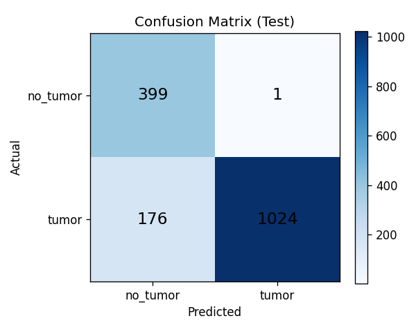
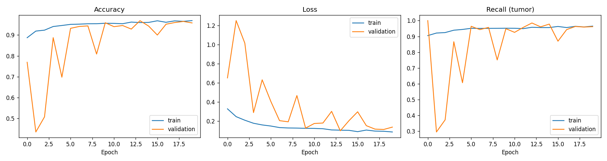

# 🧠 Brain Tumor MRI Classifier (Tumor vs No Tumor)

A CNN I built from scratch to look at a brain MRI scan and tell whether a tumor is present.

**Live app:** [Try it here] https://brain-tumor-mri-classifier-vsopp3bsnxu9fjqwgvsca2.streamlit.app/

## Why I built it this way

The original Kaggle dataset has 4 classes (glioma, meningioma, pituitary, no tumor). I merged the three tumor types into one **tumor** class to turn it into a binary screening problem: *is there a tumor or not?*

In screening, missing a tumor is far worse than a false alarm. So I didn't stop at accuracy. I focused on **tumor recall** and tuned the decision threshold for it.

## Dataset

[Brain Tumor MRI Dataset – Masoud Nickparvar (Kaggle)](https://www.kaggle.com/datasets/masoudnickparvar/brain-tumor-mri-dataset)

- Training folder → 80% train / 20% validation
- Testing folder → kept untouched as the final test set (1,200 tumor, 400 no tumor)

## Model

- Custom CNN: 4 blocks of Conv2D → BatchNorm → ReLU → MaxPool, then GlobalAveragePooling, Dropout and a sigmoid output
- Data augmentation (flip, rotation, zoom, contrast)
- Class weights for the tumor / no-tumor imbalance
- EarlyStopping and ModelCheckpoint on validation AUC, plus ReduceLROnPlateau
- Trained on Google Colab (T4 GPU)

## Results (test set)

At the default 0.5 threshold the model was too cautious: it missed **176 of 1,200 tumors**, even though ROC-AUC was 0.978. A high AUC meant the model ranked images well, so the cut-off was the problem.

I picked a new threshold on the **validation set** (target: 98% tumor recall). That gave **0.10**, and then I checked it once on the test set:

| Metric | Threshold 0.5 | Threshold 0.10 |
|---|---|---|
| Accuracy | 88.94% | **93.69%** |
| Tumor recall | 85.33% | **93.17%** |
| Tumor precision | 99.90% | 98.33% |
| No-tumor recall | 99.75% | 95.25% |
| Tumors missed | 176 | **82** |
| False alarms | 1 | 19 |

Missed tumors dropped by more than half, at the cost of 18 extra false alarms.




## Project structure

```
train.py            # trains the CNN, saves model + metrics + plots
tune_threshold.py   # picks the threshold on validation data
predict.py          # predicts one MRI image from the command line
app.py              # Streamlit web app
models/             # saved model + metadata (threshold, image size)
reports/            # metrics and plots
sample_images/      # one tumor and one no-tumor image to try the app
```

## Run it locally

```
pip install -r requirements.txt
python predict.py sample_images/tumor_sample.jpg
streamlit run app.py
```

## What I'd try next

- Transfer learning (MobileNetV2 / EfficientNetB0) to push recall higher
- Grad-CAM heatmaps to show which part of the scan the model looks at

> ⚠️ This is a learning project, not a medical device. Please don't use it for diagnosis.
